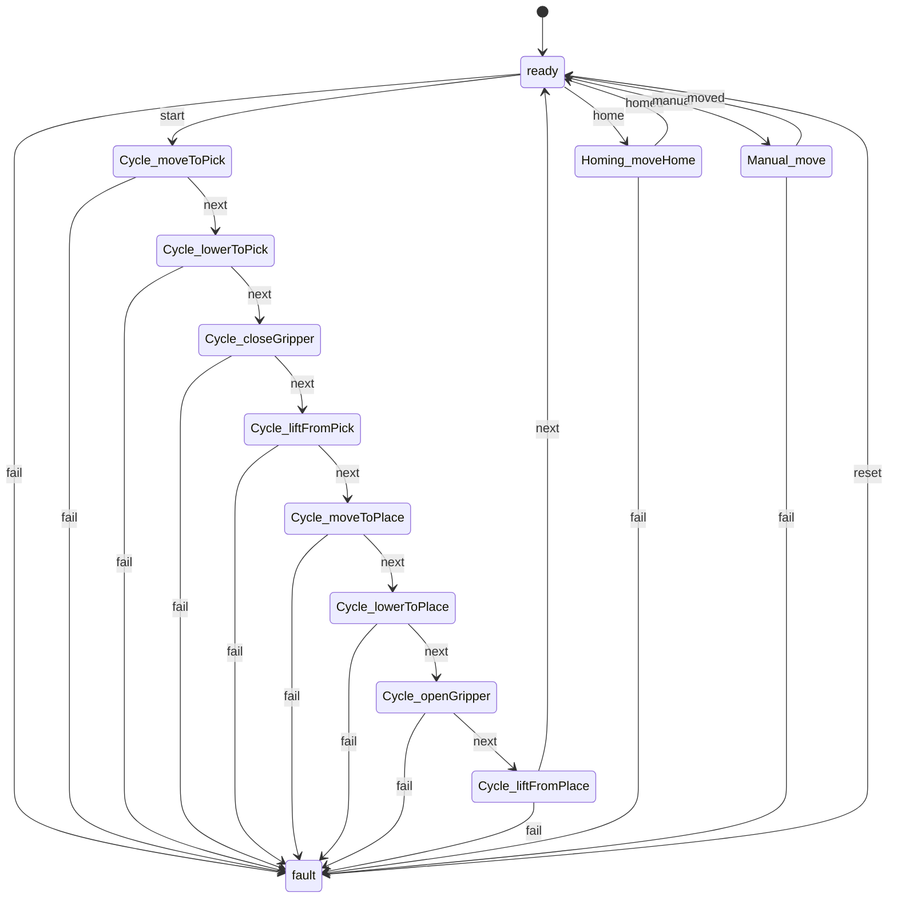

# Gantry Pick & Place

A proof-of-concept 3-axis gantry robot controller with a FastAPI backend and a
React/TypeScript operator dashboard. The robot picks a cube from **Table A**,
carries it across the cell, and places it on **Table B** using the provided
`robot_sim.py` simulator.

The backend uses:

- [`vention-communication`](https://pypi.org/project/vention-communication/) for
  Connect-style RPC actions and server-streaming telemetry.
- [`vention-state-machine`](https://pypi.org/project/vention-state-machine/) for
  the robot control state machine.
- [`vention-storage`](https://pypi.org/project/vention-storage/) for persisting
  the machine configuration in SQLite.

The frontend uses the TypeScript client generated from the proto emitted by
`vention-communication`; it never polls for live state.


---

## Quick start

### Docker Compose (recommended)

```bash
docker compose up --build
```

- Dashboard: <http://localhost:3000>
- Backend health: <http://localhost:8000/health>

The frontend nginx container proxies `/rpc` to the backend with buffering
disabled so the telemetry stream works through the proxy. The SQLite database
lives in the `gantry-data` volume, so the configuration survives restarts.

The production container has the developer fault simulator disabled. To use
it, run locally (below) or set `GANTRY_ENABLE_DEV_TOOLS=true` on the backend and
build the frontend in dev mode.

### Local development

The Vention libraries require **Python 3.10** (`>=3.10,<3.11`).

```bash
# backend
cd backend
python3.10 -m venv .venv
source .venv/bin/activate
pip install -r requirements.txt -r requirements-dev.txt
uvicorn app.main:app --reload --port 8000

# frontend (in another terminal)
cd frontend
npm install
npm run dev
```

Open <http://localhost:5173>. Vite proxies `/rpc` to
`http://localhost:8000`, so no CORS configuration is needed for the normal
development flow.

### Tests and checks

```bash
# backend: 154 tests, 99.9% coverage, ruff
cd backend
.venv/bin/ruff check app tests
.venv/bin/pytest --cov=app --cov-report=term-missing

# frontend: 81 tests, ~95% coverage, lint, typecheck, build
cd frontend
npm run lint
npm run typecheck
npm run test:coverage
npm run build
```

Or from the project root:

```bash
make test
make lint
make build
```

---

## What the dashboard does

- **Live telemetry** from the `Status` stream: robot X/Y/Z, gripper state,
  moving/idle, raw state-machine state, friendly step, cycle progress, and the
  configured cube/destination/home positions.
- **Cell view**: an SVG plan view of the 2 m × 2 m footprint with Table A,
  Table B, the robot base and current position, the cube, the destination, and
  a vertical Z gauge.
- **Controls**: Home, Start, Stop, and Reset. Buttons are enabled only when the
  state machine allows the command; Stop remains available while an operation
  is running, even if the telemetry stream drops.
- **Configuration**: cube start, destination, home, speed, and approach height.
  The form validates locally and the server validates again. Configuration is
  persisted through `vention-storage`.
- **Error and connection states**: a red fault banner with Reset, a connection
  banner with automatic stream reconnect, and a dismissible command result
  alert.
- **Activity log**: the `Events` stream plus `RecentEvents` on reconnect, so the
  log is not empty after a page reload.

---

## Coordinate convention

The application uses a robot-centred Cartesian frame in millimetres:

| Item | Convention |
| --- | --- |
| Origin | Robot base centre |
| +X | Right in the plan view |
| +Y | Up/away in the plan view |
| +Z | Up |
| Workspace | `x, y, z ∈ [-1000, 1000]` (the simulator's limits) |
| Footprint | 2000 × 2000 mm |
| Table A | `x ∈ [-1000, -500]`, `y ∈ [500, 1000]` |
| Table B | `x ∈ [500, 1000]`, `y ∈ [-1000, -500]` |

Defaults:

```json
{
  "cubePosition":        { "x": -750, "y":  750, "z": 0 },
  "destinationPosition": { "x":  700, "y": -700, "z": 0 },
  "homePosition":        { "x":    0, "y":    0, "z": 0 },
  "speed": 90,
  "approachHeight": 100
}
```

Validation rules:

- Every position must be finite and within ±1000 mm on each axis.
- Cube and destination `z >= 0` (the table surface), and
  `z + approachHeight <= 1000`.
- Home may be anywhere within the workspace, including negative Z.
- Speed is an integer from 1 to 100 mm/s. Speed 0 is rejected because
  `robot_sim.move_to` divides by the planned motion time.
- Approach height is 0 to 1000 mm.

The figure's Table B is rotated 45°; the dashboard draws it axis-aligned for
clarity. The configured coordinates are authoritative.

---

## Sequence

The required sequence is modelled as eight explicit leaf states:



| Step | Target |
| --- | --- |
| Move to cube | `(cube.x, cube.y, cube.z + approachHeight)` |
| Lower to cube | `(cube.x, cube.y, cube.z)` |
| Close gripper | — |
| Lift cube | `(cube.x, cube.y, cube.z + approachHeight)` |
| Move to destination | `(dest.x, dest.y, dest.z + approachHeight)` |
| Lower to destination | `(dest.x, dest.y, dest.z)` |
| Open gripper | — |
| Lift from destination | `(dest.x, dest.y, dest.z + approachHeight)` → `ready` |

The sequence ends lifted above the destination. Home is a separate command.

Each motion state's synchronous `on_enter` callback schedules an async step
task. The task calls `robot.move_to(...)` repeatedly until the simulator
reports the target is reached and the axis speed is zero, with a computed
timeout. This is the requirement's "call `move_to` repeatedly until motion is
complete" handled inside the state machine callbacks.

---

## API

All application traffic uses Connect RPC under `/rpc`:

| RPC | Kind | Request | Response |
| --- | --- | --- | --- |
| `GetStatus` | action | `Empty` | `StatusSnapshot` |
| `GetConfig` | action | `Empty` | `MachineConfig` |
| `SetConfig` | action | `SetConfigRequest` | `ActionResult` |
| `GetRobotPosition` | action | `Empty` | `RobotState` |
| `SetRobotPosition` | action | `MoveRobotRequest` | `ActionResult` |
| `HomeRobot` | action | `Empty` | `ActionResult` |
| `StartSequence` | action | `Empty` | `ActionResult` |
| `StopSequence` | action | `Empty` | `ActionResult` |
| `Reset` | action | `Empty` | `ActionResult` |
| `RecentEvents` | action | `Empty` | `EventList` |
| `SimulateFault` | action | `Empty` | `ActionResult` (dev tool) |
| `Status` | stream | `Empty` | `StatusSnapshot` |
| `Events` | stream | `Empty` | `Event` |

`SetRobotPosition` is a **manual move** through the same state machine, not a
teleport. It is rejected while another operation is running.

Every command returns:

```json
{
  "ok": true,
  "message": "Sequence started",
  "status": { "...": "the latest status snapshot" }
}
```

Expected domain failures (busy, invalid configuration, fault state, etc.)
return `ok: false` with a human-readable message. This is deliberate: the
pinned `vention-communication` router serializes raised exceptions into an
HTTP 200 error envelope that the generated client cannot distinguish from a
default response, so command handlers return structured results instead.

The proto is committed at `backend/proto/app.proto`. The backend emits it on
import; the frontend regenerates `src/gen/` from it before `dev`, `build`,
`typecheck`, and tests. The CI job regenerates the proto and fails if the
committed file is stale.

### Plain HTTP endpoints

- `GET /health` — Docker/CI health check.
- The storage library also mounts its CRUD routes under `/config` (writes
  require an `X-User` header). The dashboard uses the Connect RPCs, not these
  routes.

---

## Architecture

```
Browser (React 19 + TypeScript + Vite)
  │
  │  generated Connect client
  │  ├── unary actions: commands and queries
  │  └── server streams: Status (replay latest) and Events (FIFO)
  ▼
FastAPI + VentionApp (one uvicorn worker)
  │
  ├── app/api.py        @action handlers (structured results)
  ├── app/telemetry.py  @stream publishers + heartbeat
  ├── app/service.py    command serialization, validation, events
  ├── app/machine.py    PickAndPlaceMachine (vention-state-machine)
  ├── app/robot.py      RobotDriver protocol + SimRobotDriver
  ├── app/repository.py ConfigRepository + vention-storage/SQLite
  └── robot_sim.py      provided simulator, unchanged
```

### Backend layout

```
backend/
├── robot_sim.py                  # provided, unchanged
├── requirements.txt
├── requirements-dev.txt
├── pyproject.toml                # pytest + coverage + ruff
├── proto/app.proto               # generated and committed
├── app/
│   ├── config.py                 # environment settings
│   ├── models.py                 # Pydantic API/domain models
│   ├── robot.py                  # simulator adapter
│   ├── repository.py             # SQLite + in-memory repositories
│   ├── machine.py                # state machine + sequence
│   ├── telemetry.py              # streams + heartbeat
│   ├── service.py                # orchestration and command rules
│   ├── api.py                    # Connect actions
│   └── main.py                   # wiring, lifespan, proto emission
└── tests/                        # 154 tests
```

### Frontend layout

```
frontend/
├── src/
│   ├── app.tsx                   # dashboard wiring
│   ├── client.ts                 # generated Connect client
│   ├── use-stream.ts             # reconnect + stall detection hook
│   ├── components/               # SceneView, TelemetryPanel, ConfigForm, ...
│   ├── lib/                      # formatting, validation, scene math, events
│   ├── gen/                      # generated by buf, gitignored
│   └── styles.css
├── buf.gen.yaml
├── nginx.conf
└── Dockerfile
```

---

## Design decisions and trade-offs

### Python 3.10 and exact pins

The Vention packages require Python `>=3.10,<3.11`. The project pins
`vention-communication==0.3.0`, `vention-state-machine==0.3.1`, and
`vention-storage==0.5.4`. Docker uses `python:3.10-slim`; local instructions use
`python3.10`.

### Connect RPC, generated client, no polling

`vention-communication` is a Connect-compatible RPC layer, not a REST or
WebSocket library. The dashboard uses the generated client for every command
and for both streams. Live telemetry is a server stream with `replay=True`, a
latest-only queue, and a 100 ms/1 s heartbeat. The frontend reconnects with
backoff and treats 5 s of silence as a stalled stream.

### Fine-grained state machine and a custom `fail` trigger

Each sequence step is a leaf state so the dashboard can show exactly what the
machine is doing. The pinned `transitions` engine is synchronous, so entry
callbacks are synchronous and schedule async step tasks. The library's built-in
`to_fault` transition has an async before-hook that `transitions` never awaits;
the project uses its own `fail` trigger and cancels tasks explicitly from the
service instead.

State member names are camelCase because the hierarchical state-name separator
is `_`; a member named `move_to_pick` would be parsed as nested states and
crash the machine.

### Structured command results

As noted above, `vention-communication` returns HTTP 200 with an error envelope
for exceptions. Commands therefore return `ActionResult { ok, message, status }`.
The frontend displays both domain rejections and network/timeout errors.

### Robot adapter

`SimRobotDriver` centralizes the simulator's quirks:

- Rejects speed 0 before `move_to` can divide by zero.
- Rejects out-of-limits targets with a domain error.
- Converts the simulator's error string into an exception.
- `halt()` zeroes the simulator's axis speed so an interrupted move does not
  continue with its old velocity on the next command.
- Motion loops require both "at target" and "not moving", so the simulator gets
  the extra call it needs to snap exactly to the target and zero its speed.

### Persistence

A single-row SQLModel table (`gantry_config`) stores the configuration through
`vention-storage`. `bootstrap` creates the table; the `ModelAccessor` reads and
writes the row with audit logging. The repository protocol has an in-memory
implementation so unit/API tests do not depend on SQLite. If a persisted row is
invalid (manual edit/corruption), the app logs a warning, falls back to
defaults, and rewrites the row.

### One uvicorn worker

The robot, state machine, telemetry loop, and SQLite configuration are
process-local. Running multiple workers would create multiple independent
robots and split the telemetry stream, so the Docker command and documentation
use exactly one worker.

### Custom dashboard instead of an HMI component library

The dashboard uses React 19 + Vite + custom CSS and an SVG plan view. This
keeps the bundle small, avoids React 17 peer constraints from Vention's
pendant-oriented UI packages, and makes the scene math easy to test. The
provided figure is a 2D plan view; a 2D SVG is the clearest representation.

### Testing strategy

- **Backend:** 154 tests. A deterministic `FakeRobot` exercises the state
  machine without sleeping; the real simulator adapter is tested with a patched
  clock; the SQLite repository is tested with a temporary database and a
  simulated restart; the Connect actions are exercised through the real ASGI
  app; a real uvicorn subprocess verifies the stream framing; the proto is
  checked against the Python surface. Coverage is 99.9% of `app/`.
- **Frontend:** 81 tests with Vitest + React Testing Library. Scene math,
  validation, event merging, every component state, the stream hook's
  reconnect/stall/unmount behavior, and the app's loading/connected/fault/
  disconnected flows. Coverage is ~95%.
- **CI:** GitHub Actions runs backend lint/tests/proto check and frontend
  lint/typecheck/coverage/build on every push and pull request.

### Assumptions and limitations

- This is a simulation: no real hardware, collision detection, inverse
  kinematics, or safety PLC.
- The cube is represented by its pick point; its physical size is not modelled.
- Table B's rotation in the figure is illustrative; the dashboard uses an
  axis-aligned region. Configured coordinates are authoritative.
- One operator, one browser, one backend worker, no authentication.
- The `SimulateFault` action is a demo aid. It is always in the proto but the
  backend refuses it when `GANTRY_ENABLE_DEV_TOOLS=false`; the frontend hides
  the button outside Vite dev mode.
- The storage CRUD routes are mounted by `vention-storage`; they are not part of
  the dashboard's flow.

---

## Demo walkthrough

1. `docker compose up --build` (or run the backend and `npm run dev` locally).
2. Open the dashboard. The robot starts at home `(0, 0, 0)`; the cube is at
   Table A and the destination at Table B.
3. Click **Start sequence**. Watch the state badge, step label, X/Y/Z readouts,
   scene markers, and progress bar advance through the eight steps.
4. The sequence ends lifted above Table B. Click **Home robot** to return.
5. Edit the cube or destination coordinates and click **Save configuration**.
   Reload the page; the values are restored from SQLite.
6. In local dev, open **Developer tools → Simulate fault** to see the red fault
   banner, then click **Reset fault**.
7. Click **Stop** during a sequence to halt at the current position; Start is
   available again afterwards.

---

## Submission checklist

- [x] `vention-communication` Connect RPC + streams
- [x] `vention-state-machine` control logic
- [x] Provided `robot_sim.py` used unchanged; `move_to` polled to completion
- [x] Get/Set robot, cube, destination, home; Home, Start, Get Status
- [x] Full pick-and-place sequence
- [x] Dashboard telemetry, controls, error/state visuals
- [x] `vention-storage` persistence across restarts
- [x] Backend and frontend tests
- [x] Docker Compose single command
- [x] README with setup, design decisions, assumptions, trade-offs

The implementation plan and approval record live in `../PLAN.md`.
